# ProPoker

**The clock, the tables and the money for your poker night, on one phone or tablet.**

✓ 100% free · ✓ No ads · ✓ No tracking · ✓ No account · ✓ Works offline · ✓ Open source

Open it at **https://dbugger85.github.io/propoker/**. There's nothing to sign up for, and your tournaments are saved only on your own device (export them to a file to keep a copy). It's in English and Norwegian.

<p>
  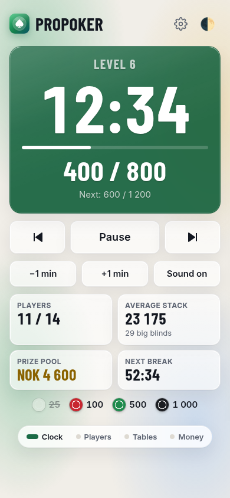
  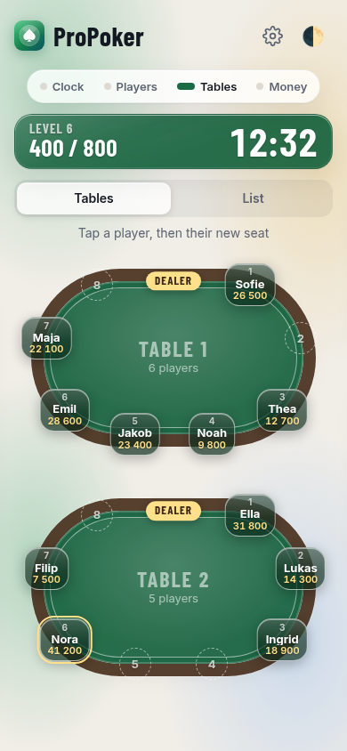
  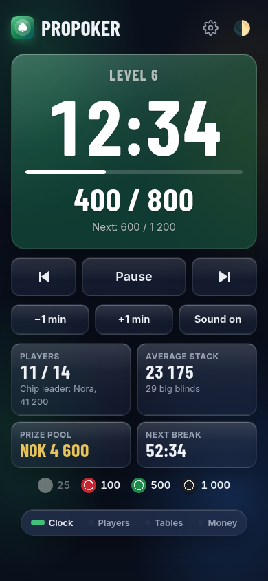
</p>

## What it does

- **A big blind clock** with sounds: two beeps at one minute left, and a chime and a big announcement at every new level and break. It keeps the right time even if the phone locks.
- **Blind structures**: Turbo (12-minute levels), Standard (20) and Deep (25), or your own. Or say how long the tournament should be, and the app works out the blinds. Change any level, add levels and breaks, and drag a break to where you want it. The cog shows the clock time each coming level starts and ends, and the times move with every pause.
- **Players and knockouts**, with who knocked whom out. Rebuys, add-ons, late entry, players who leave, and undo. Mistakes found later can be fixed too: take back a rebuy, change someone's finishing place, or put back someone who wasn't out.
- **Several tables, drawn from above**, with where the dealer stands and each player's chips. A random seat draw, then the app tells you when to move a player, when to close a table, and when it's the final table. You can also move players yourself.
- **Chip counts at the breaks**: type in each stack, table by table. The app checks the total against the chips in play and shows the chip leader and each stack in big blinds.
- **Your chip set**: each colour (or your own colour) and its value, how many of each chip every player starts with, and whether your chips are enough for everyone. Chips are game points, not money.
- **Money**: buy-ins, rebuys and add-ons, who has paid what (nobody has paid at the start), the prize pool and the prizes.
- **At the end**: the full ranking, who sends what to whom with as few transfers as possible (for Vipps and the like), and a text to share in the group chat.
- **All your tournaments in one place**: the main menu lists every tournament, set up, running or finished. Go back to the menu and into the game at any time, start a new one with the same setup, or delete old ones.
- **A backup file**: export everything to one file, and import it again, for example on a new phone.
- **Links**: share your settings and players with another organiser, or carry on with a running tournament on another phone or tablet.

On a tablet held sideways, the clock fills the left half like a TV, with players, tables and money on the right.

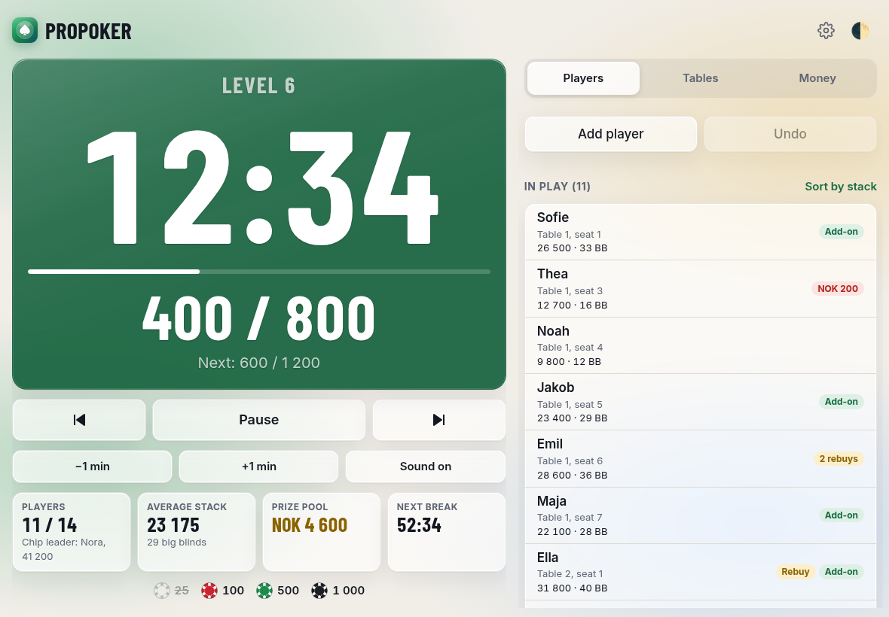

## How to run a tournament

### 1. Set up
Tap **New tournament** and fill in from top to bottom. Everything is saved as you type.

- **Tournament**: name, currency, buy-in, starting chips, and an optional house fee per player (for food and drinks; it doesn't go into the prize pool).
- **Players**: type a name and tap **Add**. Names from earlier nights show up as buttons you can tap to add; tap **Edit** next to them to remove names you don't need any more. The players come early because the chips check, the tournament length and the payouts all depend on how many there are.
- **Chips**: your chip colours and what each is worth. Pick a colour from the list, or **Own colour…** for any colour. The chips sort by value (or tap **Sort by value**). Fill in **You have** to check that your chips are enough for everyone. The blinds are rounded to your smallest chip. The app suggests how many of each chip every player starts with; tap **Choose the chips** to set your own.
- **Blinds**: pick Turbo, Standard or Deep, or tap a level to change it (big blind first; the small blind follows, and **Ante same as big blind** makes a BB ante). Minutes per level and per break apply to every level. Drag a break by its handle to put it somewhere else. **Tournament length** (1½ to 8 hours) works out the blinds for you: as many levels as fit in the time, rising in even steps until the big blind is about 1/20 of all the chips, when the game should be over. It counts the players you've added, about half of them rebuying once and most taking the add-on, and follows along when you change players, chips or minutes. Your own levels are kept under **Custom**, so you can look at a preset and come back. Antes are optional: one ante the size of the big blind (BB ante), or a small ante from every player (Classic).
- **Rebuys and add-ons**: the price, the chips, and the last level they're allowed. The add-on is offered at the break after the last rebuy level.
- **Tables**: seats per table (2–12), and whether seats are drawn at random.
- **Payouts**:
  - **Automatic**: 1 paid place up to 4 players, 2 from 5, 3 from 8, 4 from 14 and so on. It pays one place fewer if the last one would win less than the buy-in.
  - **Percentages**: you choose the places and each place's percent.
  - **Fixed**: for example NOK 500 for 2nd and the buy-in back for 3rd, with the rest to the winner.

<p>
  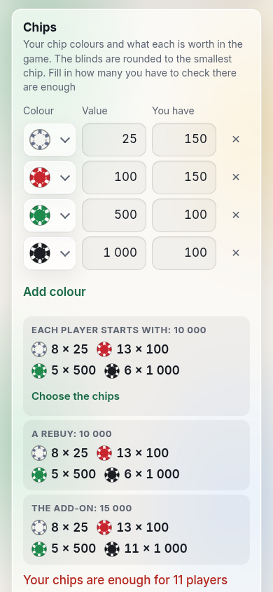
</p>

**Share these settings** at the bottom sends a link with all of this and the players' names. Whoever opens it is asked first, and then gets the same setup. **Reset all settings** next to it puts every setting back to how it was the first time (the players and saved names stay); the message that follows has **Undo**.

Tap **Start tournament**. The seat draw shows where everyone sits.

### 2. Play
- **Start the clock** when everyone is seated. **Pause** stops it. The arrow buttons go to the next level, or back (the first tap restarts the level, a second goes to the one before). ±1 min adjusts the time.
- The bar at the top switches between **Clock, Players, Tables and Money** (or swipe). On a tablet held sideways, use the tabs instead.
- **Tap a player** to knock them out, give a rebuy or an add-on, record a payment, change their seat, count their chips, rename them (the pencil by the name), or record that they left. If you tap by mistake, use **Undo**.
- **Fixing mistakes later**: **Take back a rebuy** (someone put back in by mistake goes back out in the same place, and the money leaves the pot). For players who are out: **Change place**, **Knocked out by** and **Not out after all**.
- **Late entry**: **Add player** on the Players page. The new player gets a seat where there's most room.
- **The Tables page** shows each table from above, with the seats round the edge, where the dealer stands (turn that off in the cog), each player's chips and the chip leader in gold. **List** at the top switches to a plain list of seats.
- When tables need evening out, a popup lists **who moves where**, and the players who must move pulse orange with their new seat. Tap **They have moved** once it's done, or **Someone else** to pick a different player.
- **Move players by hand**: on the Tables page, tap a player and then the new seat, at the same table or another one. If the seat is taken, the two players swap.
- At a break the clock page says when the smallest chips are no longer needed (**colour up**).
- The **cog** (⚙) changes sounds, cut-off levels, seats per table and the coming levels, with the clock time each one is expected to start. It also has **Count chips**, **Continue on another device** and **End tournament**: if players are still in, they can make a deal and split the rest of the prize money.

<p>
  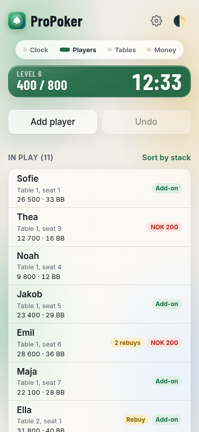
  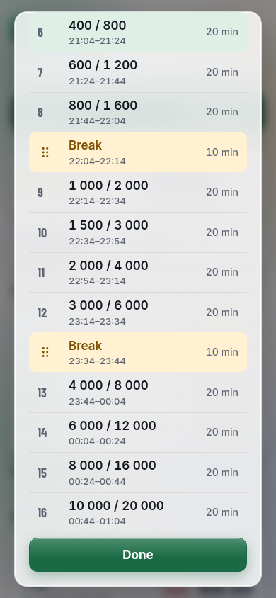
  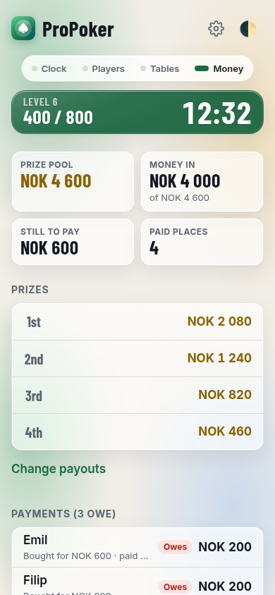
</p>

### 3. Count the chips
At a break, tap **Count chips** under the clock (or in the cog at any time, or **Chip count** for one player). Type each player's chips, table by table; Enter jumps to the next box. At the bottom it says whether the total adds up with the chips in play ("Adds up", "2 000 missing"). The Players page then shows each stack in big blinds and the chip leader, and can sort by stack. Rebuys and add-ons after a count are added to the stack.

<p>
  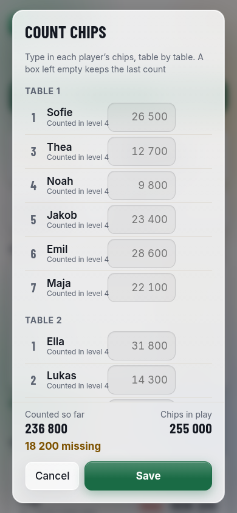
</p>

### 4. Payments
Nobody has paid at the start. Tap a player on the Money page (or **Payment** in their options) and choose **Paid everything**, **Paid part** or **Not paid**. The list shows who still owes what, and a rebuy after paying shows them owing again.

### 5. The end
When one player is left, the summary shows everyone's place, who knocked them out and the prizes. **Settle up** lists who sends what to whom, with as few transfers as possible. Choose who has the money already paid in (**The bank**, someone not playing, or a player), and they pay it out. **Won and lost** shows each player's prize minus what they bought. **Share results** sends the ranking, prizes and transfers to the group chat. **Main menu** goes back to your tournaments, and **Play again** starts a new one with the same setup and players. **Undo the last knockout** (or **Undo the deal**) below them takes you back into the game if it was a mistake.

<p>
  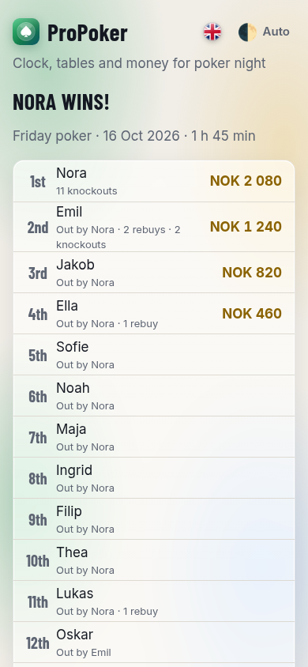
  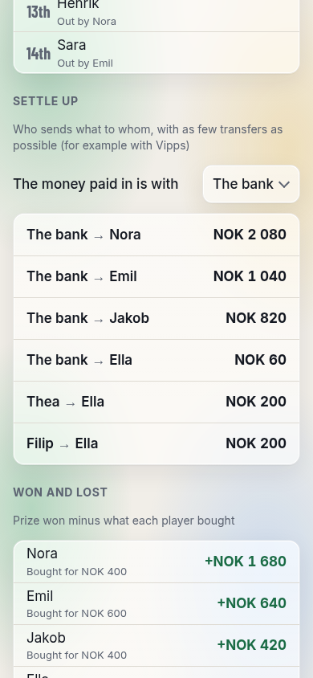
</p>

## Your tournaments
The main menu lists every tournament you've made: ones still being set up, ones being played (with the level and how many are left) and finished ones (with the winner). Tap one to go back to its setup, the game or the results. The **house button** at the top takes you to the main menu at any time, also in the middle of a game; the clock keeps running, and tapping the game takes you back. Only one clock runs at a time: opening another tournament pauses the one you left.

The **⋮** button on each one has **New tournament with this setup** (a copy with the same settings and players, under a new name) and **Delete**. **New tournament** at the top starts from scratch.

<p>
  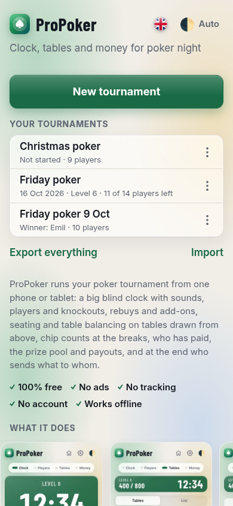
</p>

**Export everything** saves one file with all your tournaments, settings and saved names (or sends it with the share sheet). **Import** reads such a file back, for example on a new phone; tournaments you already have are replaced by the file's copy, and the rest stay.

## Carry on on another device
**Continue on another device** (in the cog) sends a link with the whole tournament: the clock, players, seats, payments and chip counts. Open it on the other phone or tablet and carry on there; it's added to that device's tournaments. Use only the new device afterwards; the two don't keep each other up to date.

## Install it like an app
- **Android (Chrome)**: tap **Install** on the start page.
- **iPhone/iPad (Safari)**: tap **Share** → **Add to Home Screen**.

It works offline once it has been opened.

## Privacy
No ads, no tracking, no cookies, no account. There's no server: the app is a plain website on GitHub Pages, and your tournaments, settings and players are saved only in your own browser. **Export everything** is the way to keep a copy: the file goes wherever you save or send it, and nowhere else. Shared links carry their contents in the link itself, after the "#", which browsers never send to the website.

## For developers
Plain HTML, CSS and JavaScript: no framework and no build step. See [CLAUDE.md](CLAUDE.md) for how it's built and [PLAN.md](PLAN.md) for the plan and the decisions.

```
npm install
npm start            # http://localhost:8000
npm test             # the rules: blinds, clock, tables, money, chips, links, translations
npm run e2e          # whole tournaments in a browser (needs Chromium)
npm run screenshots  # the pictures in this README and on the start page
```
